# P3 application contract and integration review

**24 November 2026 owner disposition:** P3.1–P3.7 explicitly accepted as the provisional synthetic application contract only. P3.8–P3.11 and production/real source decisions remain open. See [workspace contract](BUYER_WORKSPACE_UX_V1.md), [geographic contract](SYNTHETIC_GEOGRAPHIC_EVIDENCE_V1.md) and [current checkpoint](../CHECKPOINT.md). The pending synthetic approval descriptions below are dated history. P3 10%, weighted MVP 22.8% unchanged pending formal exit.

**Current synthetic-only contract review (reconciled 23 November 2026):** Owner-approved P3/P4/P5/P6 application integration reached [`development` application commit `44e278f`](https://github.com/Sonkhe-Shongwe/house-price-intelligence/commit/44e278f5ff68475616d889d2c7fafd0b5b3c6304) via PRs #5 and #6. **172 Python + 9 real Chromium** tests passed on that merge, with opt-in restart-safe fictional SQLite shortlists. The earlier `5e0a7f3` review is a dated historical P3 milestone, not the current integrated build. **Scope remains strictly fictional-data-only and not an owner-approved production architecture, real address resolver, authenticated database or permitted publisher-data display.** See the [checkpoint](../CHECKPOINT.md) for later code/CI status and the [P6 shortlist contract](P6_SYNTHETIC_SHORTLIST_CONTRACT.md) for the extension.

The **current synthetic contract is stated first below**. Dated implementation-stage notes afterwards explain how the prototype evolved and are **historical**, not competing requirements. Apply the [engineering contract](ENGINEERING_CONTRACT.md), [lean directive](LEAN_ENGINEERING_DIRECTIVE.md) and [P0–P8 acceptance roadmap](../P_PHASE_ROADMAP.md).

## Current synthetic API and data contract on `development`

**Verified integrated code:** [development integration CI 45254283750](https://github.com/Sonkhe-Shongwe/house-price-intelligence/actions/runs/45254283750) and [push CI 45254270906](https://github.com/Sonkhe-Shongwe/house-price-intelligence/actions/runs/45254270906) passed **172 Python, 9 actual Chromium browser journeys**, JavaScript and documentation checks at exact merge SHA `44e278f`. Later documentation-only commits do not change the API. No P3 owner acceptance, public release or permission to use real-property data is implied.

**Identity and journey:**

1. `POST /v1/addresses/search` accepts a bounded JSON `{"query":"Fictional Way"}`, returns invented `address_id` candidates, no PIN and an explicit ambiguity hint when multiple parcels share a fictional street label. A query with no match is not converted into a guessed property.
2. `GET /v1/addresses/{address_id}` resolves **an explicitly selected candidate** to a fictional 14-digit parcel PIN, `identity_scope=parcel_only` and `building_identity_verified=false`. This does not prove the physical building, legal title or real street address. A PIN-first technical path still exists for synthetic testing.
3. `POST /v1/investigations` accepts top-level `township_code`, `class_code`, `analysis_date` and `subject`. Subject allows `pin`, optional `address_id`, `building_area_sqft`, optional `asking_price_usd` decimal text and optional `label`. A selected address ID may supply the PIN; if both are sent they must match the server's SQLite mapping. Unknown IDs and conflicts fail HTTP 422 without creating an investigation. Caller-provided source values, coordinates, neighbourhood, comparables and source/build IDs remain forbidden.
4. The server chooses synthetic curated source snapshots and eligible historical transactions. The existing Phase 2 neighbourhood-first matcher excludes inappropriate future/duplicate/multi-parcel sales and labels 2 km fallback exploratory; no sale price is used for eligibility/rank.
5. `POST /v1/investigations` responds HTTP 201 with an investigation ID and `Location`; `GET /v1/investigations/{uuid}` reopens the original stored evidence. API statuses: `supported_neighbourhood`, `exploratory_spatial`, `insufficient_data` and `out_of_coverage`. `valuation` is always `null`. Unsupported-but-well-formed enquiries can be saved without fabricated evidence.

**Money and provenance:** The SQLite-backed HTTP response has `contract_version="p3-draft-v0.3"`. Each reported comparable contains fixed-two-decimal USD text `sale_price_usd` (for example `"525000.01"`) derived from trusted integer cents; **no JSON numeric `sale_price`** is disclosed by this HTTP result. Buyer `asking_price_usd` is user-reported, not a verified listing or sale. Direct pure research adapter fixtures still use their earlier v0.2 numeric representation and are **not the current HTTP contract**. Original comparable transaction IDs, source snapshots/roles, cents and response hash are checked on reopen; changed fictional address/parcel mapping also fails closed. These checks are not a production cryptographic attestation.

**Database and lifetime:** Immutable `schema_draft.sql` is fixture v1 (**16 domain tables**); v2 adds query indexes; v3 adds `synthetic_address_candidates` (**17 domain tables**). `schema_migrations` is the control table (**18 total**, excluding SQLite internal metadata). The runner verifies checksums/history and checks foreign keys **before committing** fixture migrations. The default server uses disposable in-memory SQLite; explicit `--fixture-db` opens a validated local fictional database that preserves investigation, shortlist and notes across restarts. The `shortlists` and `shortlist_investigations` tables are pre-existing schema, now used by integrated P6 endpoints. The older `synthetic_address_index` remains migration history; new candidate lookup uses `synthetic_address_candidates`. This remains neither a production DB/migration policy nor a real address provider.

**Safe use boundary:** The WSGI server is explicitly fixture-only and loopback-bound. Research pilot township 17 and Class 203, first-market identity, property-level publication/attribution rights, historical as-of proof, general currency/limits, production storage/auth, final UX and any public deployment remain undecided. Treat the [proposed ERD below](#proposed-domain-erd-and-controlled-fixture-migration) as an implementation candidate, not a signed-off production model.

## P3 acceptance review and unresolved architecture boundary

A per-package P3.1–P3.11 **technical readiness review and proposed owner dispositions** is now recorded in the [decision register](../DECISIONS.md#p31p311-contract-readiness-and-owner-acceptance-review-23-november-2026). The current v3/HTTP-v0.3 synthetic contract is **eligible for fixture-only approval** on P3.1–P3.7, but has **not been signed off**. P3.8 hosting/access and P3.9 final UX/security are partial; P3.10 rights/real-market identity and P3.11 overall acceptance remain unresolved. No public release or real property display is authorised, and P3 remains 10%.

**Technical review caveat (corrected after PR #5):** The current `schema_migrations.py` runner validates deferred foreign-key integrity **before the fixture schema transaction commits**, and rolls back failures. This improves the synthetic migration proof but **does not establish production backup/restore, concurrent access or an authenticated database**. Real-source publication timing and address-to-building identity still require independent evidence, not more invented-fixture test cases.

## Historical P3 baseline and implementation evolution (retained for provenance)

*The following original PIN-first/15-table and interim v0.2 sections describe **older states**; their constraints, field lists, source code and status claims are superseded by the current synthetic contract above. Subsequent dated v0.3/v3 addenda preserve the actual changes and remain design evidence.*

## Buyer journey implemented with synthetic fixtures

1. The local page accepts a 14-digit invented parcel PIN, building area, optional user-reported asking price and label, and analysis date. Pilot township `17` and assessor class `203` are fixed for this demo. PIN is an internal lookup key, **not** approved consumer address search.
2. The local HTTP boundary validates the request and passes it to a SQLite fixture store. Only the server chooses the curated build, its source snapshots, location, assessments and recorded transactions.
3. The store resolves the subject using exactly one prior-tax-year assessment from the selected build; missing or ambiguous records abstain. Candidates are restricted to eligible transactions from the same build. Multi-parcel sales are excluded as individual-house comparables.
4. The unchanged Phase 2 matcher applies earlier-only sale dates, unique comparable PINs, class and township restrictions, floor-area tolerance, neighbourhood preference and bounded exploratory geographic fallback. Prices do not influence eligibility/ranking.
5. The store saves an investigation, selected evidence and a hash of the frozen response in one SQLite transaction. The result can be reopened by UUID; tampered or inconsistent saved evidence fails closed.
6. The page displays fabricated comparables, selection explanations, evidence status, provenance and warnings. No numerical valuation is returned. Saved records disappear when the local in-memory server stops.

**Run locally, with explicit fixture opt-in:**

```bash
python -m backend.run_synthetic_api --fixture-only --port 8765
```

The server listens only on `127.0.0.1`. It is not authorised for public deployment, importing real records, user accounts or client data. Python standard library and SQLite are sufficient for this isolated slice.

## HTTP and status contract

| Method and path | Meaning |
| --- | --- |
| `GET /` | HTML application |
| `GET /assets/styles.css`, `GET /assets/app.js` | Exact allowlisted browser assets |
| `GET /health` | `{ "status": "ok", "mode": "synthetic_fixture_only" }` |
| `POST /v1/investigations` | Validate, investigate, save and return an invented-fixture result; HTTP `201` plus `Location` |
| `GET /v1/investigations/{uuid}` | Reopen saved immutable result; HTTP `200`, or `404` when absent |

The `POST` request is JSON with allowed top-level fields `township_code`, `class_code`, `analysis_date` and `subject`. Allowed subject fields are `pin`, `building_area_sqft`, `asking_price_usd` and `label`. Caller-provided coordinates, neighbourhood codes, source metadata, candidate lists, synthetic flags and IDs are prohibited. An illustrative valid request:

```json
{
  "township_code": "17", "class_code": "203", "analysis_date": "2024-07-01",
  "subject": {
    "pin": "00000000000001", "building_area_sqft": 1600,
    "asking_price_usd": "500000.00", "label": "Synthetic buyer example"
  }
}
```

The service uses one of four **API-facing statuses**:

| Status | Meaning and pricing restriction |
| --- | --- |
| `supported_neighbourhood` | At least the policy minimum eligible sales in the same assessor neighbourhood; sale evidence is descriptive, not a validated valuation |
| `exploratory_spatial` | Bounded nearby sales only; carries the fallback accuracy warning, no valuation |
| `insufficient_data` | Missing PIN, absent/ambiguous assessment, weak sale coverage or missing trusted location; abstain |
| `out_of_coverage` | Unsupported market/class or resolved property outside scope; abstain |

The internal matcher retains `same_neighborhood` and `spatial_fallback` tier names; these are **not** the external status spellings. `valuation` is always `null`. The asking price is `user_reported`. A result records analysis date, immutable investigation ID, a curated `data_build` (build ID, UTC creation, source snapshot IDs, synthetic source type) and the provisional rule/contract version. Historical as-of availability and public source-display approval are both explicitly false in this candidate.

Validation errors use HTTP `422` with a field/code, malformed JSON uses `400`, missing/oversize bodies use `411`/`413`, invalid media type uses `415`, unavailable evidence uses `503` without raw SQL or source details, and unknown/mismatched routes use `404`/`405`. An unsupported-but-well-formed investigation is **a saved response**, not a validation exception. The local server rejects cross-origin/remote traffic and serves no general filesystem paths; these controls do **not** turn it into a production security boundary.

## SQL and source integrity

The 15-table proposed SQLite schema separates source snapshots, curated builds, parcels, buildings, sale transactions, transaction-parcel links, assessment-year records, geography, investigation responses/evidence and shortlists. It preserves: 14-digit PIN identity, one transaction across multiple parcels, unambiguous prior-year characteristics, correct snapshot roles, source-build membership, composite evidence foreign keys, transaction rollback, and saved evidence integrity checks. Shortlist tables exist in the proposed schema, **but shortlist creation and comparison are not implemented user features**.

The synthetic fixture store refuses non-synthetic builds. A string `synthetic-` marker is an extra safeguard against accidental dataset mixing, not cryptographic evidence that any arbitrary imported dataset is invented. There is no real-data ingestion, trusted public address resolver, authentication model, production migration strategy, independently validated price prediction, or permission to display property-level Cook County records.

## Current `development` experiment: fictional address selection (not final P3 approval)

**Added on 23 November 2026 to permanent `development` branch** at [`07f637b`](https://github.com/Sonkhe-Shongwe/house-price-intelligence/commit/07f637b1f0f9d04972911400381e38bda2687ba9). The stable `main` candidate described in the historical sections above remains a PIN-first contract until a reviewed integration. The P3 schema now includes a **16th synthetic-only index table on `development`**, not a production migration or sourced residential-address database.

| Development-only endpoint | Meaning |
| --- | --- |
| `POST /v1/addresses/search` | JSON `{"query":"Fictional Way"}`; matches zero or multiple invented address records, returning **candidate IDs and labels only**, with `source_kind=synthetic_fixture` and no automatic selection |
| `GET /v1/addresses/{address_id}` | Resolve an explicitly selected synthetic candidate ID to its stored parcel PIN; `identity_status=synthetic_mapping_only`; not a real building/address geocode |
| Existing `POST /v1/investigations` | Re-validate the user enquiry and independently resolve the chosen PIN against the trusted curated synthetic build; browser labels and client attributes are **never** trusted as publisher evidence |
| Existing `GET /v1/investigations/{uuid}` | Reopen frozen synthetic evidence with its saved price and source snapshot guards |

The search is a small bounded, parameterised SQLite lookup. It rejects unexpected fields and invalid query strings, returns no plausible address on zero matches, displays several choices without guessing and requires an explicit browser click. Existing origin/remote restrictions and fixture-only safeguards still apply. Four invented "Fictional Way" labels are used purely for integration testing; none represents a confirmed Evanston address or rights-approved consumer service. No real geocoder, external map service, published listing or valuation was added.

**Verification:** [development push CI 45193537292](https://github.com/Sonkhe-Shongwe/house-price-intelligence/actions/runs/45193537292) passed **132 Python tests, JavaScript syntax, docs checks and 5 actual Chromium -> HTTP -> SQLite scenarios** including supported search/select/reopen and no-match safety. It is integrated into the **development working branch only** and included in [draft PR #4](https://github.com/Sonkhe-Shongwe/house-price-intelligence/pull/4). P3 exit approval, exact-money API, real identity model and dataset display permissions remain unresolved.

## New `development` refinement: selected-address identity and exact-money v0.3 (provisional)

Added at [`79a7c4d`](https://github.com/Sonkhe-Shongwe/house-price-intelligence/commit/79a7c4dfcb0e1c2e1543b138539c28aa5a118eae) on `development`, verified by [CI 45196929621](https://github.com/Sonkhe-Shongwe/house-price-intelligence/actions/runs/45196929621) (**137 Python + 6 real Chromium tests**, JavaScript and docs checks). These are *draft synthetic-only* endpoint changes, not approved final P3 or production contracts.

**Selected property binding:** `POST /v1/investigations` may include `subject.address_id` with a lowercase, bounded ID. The request may omit `subject.pin` when that ID is provided. SQLite resolves the ID from the invented address index into the canonical synthetic PIN inside the same server-side investigation path. If both PIN and ID are supplied, disagreement returns `422` with `field=subject.address_id, code=identity_conflict`; an unknown ID returns `address_not_found`. Neither condition writes a saved investigation. On a valid selection the saved result includes `subject.address_id`, canonical `subject.pin` and `subject.identity_status=synthetic_mapping_only`. An unselected technical PIN remains allowed in this fixture-only internal demo. The browser discards address selection when the buyer manually edits the PIN or types a different search.

**Fixed-scale response money:** For **synthetic HTTP investigations only**, `contract_version` is `p3-draft-v0.3`. Every disclosed comparable has `sale_price_usd` as canonical two-decimal **text**, such as `"525000.01"`, sourced from exact `price_usd_cents` in SQLite, and no numeric `sale_price` member. The frontend uses text and integer grouping, not floating-point conversion. Saved-result validation binds this string to the same exact cents, transaction, snapshot, sale authorisation and stored response hash. `subject.asking_price_usd` remains buyer-entered decimal text and `valuation` remains `null`.

The **pure Phase 2 matcher** remains numerically unchanged for research. The direct `build_investigation` *research adapter* retains its dated v0.2 fixture and numeric `sale_price` for compatibility; the SQLite-backed HTTP envelope performs the v0.3 conversion. The API is a synthetic demonstration, not an approved general-currency/production money contract. Do not use any of these fictional records as real property evidence.

## Proposed domain ERD and controlled fixture migration

**Source:** `backend/schema_draft.sql` and `backend/schema_migrations.py`, added to permanent `development` at [8ed4269](https://github.com/Sonkhe-Shongwe/house-price-intelligence/commit/8ed4269af18e42add85726ae0fd45e406b8019c4). This is a *synthetic-only candidate*, not the approved production model. The baseline has 16 application/fixture tables, and the version runner adds an independent `schema_migrations` table.

```mermaid
erDiagram
    SOURCE_SNAPSHOTS ||--o{ CURATED_BUILD_SOURCES : supplies
    CURATED_BUILDS ||--o{ CURATED_BUILD_SOURCES : includes
    CURATED_BUILDS ||--o{ CURATED_BUILD_TRANSACTIONS : selects
    SALE_TRANSACTIONS ||--o{ CURATED_BUILD_TRANSACTIONS : belongs_to
    SOURCE_SNAPSHOTS ||--o{ SALE_TRANSACTIONS : records
    SALE_TRANSACTIONS ||--o{ SALE_TRANSACTION_PARCELS : links
    PARCELS ||--o{ SALE_TRANSACTION_PARCELS : participates_in
    PARCELS ||--o{ BUILDINGS : may_contain
    PARCELS ||--o{ ASSESSMENT_RECORDS : observed_by
    BUILDINGS |o--o{ ASSESSMENT_RECORDS : optional_identity
    SOURCE_SNAPSHOTS ||--o{ ASSESSMENT_RECORDS : supplies
    PARCELS ||--o{ PARCEL_GEOGRAPHIES : located_by_year
    SOURCE_SNAPSHOTS ||--o{ PARCEL_GEOGRAPHIES : supplies
    PARCELS ||--o| SYNTHETIC_ADDRESS_INDEX : legacy_fixture_mapping
    PARCELS ||--o{ SYNTHETIC_ADDRESS_CANDIDATES : candidate_or_alias_only
    CURATED_BUILDS ||--o{ INVESTIGATIONS : frozen_build
    PARCELS |o--o{ INVESTIGATIONS : optional_subject
    INVESTIGATIONS ||--o{ COMPARABLE_EVIDENCE : preserves
    SALE_TRANSACTIONS ||--o{ COMPARABLE_EVIDENCE : selected_record
    INVESTIGATIONS ||--|| INVESTIGATION_RESULTS : frozen_response
    SHORTLISTS ||--o{ SHORTLIST_INVESTIGATIONS : contains
    INVESTIGATIONS ||--o{ SHORTLIST_INVESTIGATIONS : belongs_to
```



| Entity/grain | What it means | What cannot be inferred |
| --- | --- | --- |
| Parcel PIN | 14-digit parcel identity, with leading zeroes | The parcel contains one building, or had one residential sale |
| Building | Optional physical building identity belonging to a parcel | A historical assessment card identifies a verified building |
| Assessment record | Snapshot, parcel, tax year, card combination | Publisher data were available on the sale date |
| Sale transaction and transaction-parcel link | One source sale with zero or more parcel links; a transaction can link multiple parcels | A multi-parcel transaction's full price belongs to each parcel |
| Curated evidence build | Explicit source snapshots and role membership | All sources were independently historically available |
| Investigation and selected evidence | Buyer enquiry, source-bound transaction and frozen response | An appraisal, live listing, or current valuation |
| Fictional address index | Deliberately invented one-to-one v1/v2 fixture index; retained for versioned history | Real address-to-building-to-parcel cardinality, coverage or usage rights |
| Fictional parcel candidates (v3) | One candidate ID maps to exactly one fictional parcel; identical display address may have multiple candidates and a parcel may have several fictional aliases | A building is verified or a real address is resolved from a publisher |

**Provisional SQLite migration contract:** The existing `schema_draft.sql` becomes the immutable v1 fixture script. Numbered `migrations/0002_fixture_query_indexes.sql` adds three relational query indexes. The runner requires foreign keys, contiguous recorded history, valid script SHA-256 hashes and matching SQLite `PRAGMA user_version`. It applies DDL and history updates inside an explicit transaction, rejects unknown existing databases, refuses downgrades and rolls back a failed migration. Existing data and a saved synthetic investigation survive a tested v1-to-v2 upgrade.

[GitHub Actions PR run 45200054027](https://github.com/Sonkhe-Shongwe/house-price-intelligence/actions/runs/45200054027) passed **144 Python tests** and **6 real Chromium journeys**, including 7 new fixture migration checks. The corresponding [development push CI 45200038440](https://github.com/Sonkhe-Shongwe/house-price-intelligence/actions/runs/45200038440) also passed.

**P3 acceptance still open:** The team must review the true parcel/building/address relationship for a rights-approved first market, choose the production SQL/migration/backup policy, validate historical availability and provenance, approve the money and endpoint contracts, and review privacy/security. The fixture-only runner is **not** a production migration, backup solution, publicly served dataset or release authorisation.

## Development-only v3: explicit ambiguous-address parcel selection

**Implemented** on permanent `development` at [`25008ee`](https://github.com/Sonkhe-Shongwe/house-price-intelligence/commit/25008ee64f6f6c80c9fb0e31e5df9092d2de9f46), with fixture/CI corrections at [`3793b81`](https://github.com/Sonkhe-Shongwe/house-price-intelligence/commit/3793b814d09ecd16724578df405b691578d5d979).

The **immutable v1 baseline** still contains 16 domain/fixture tables. v2 adds indexes; **v3 adds `synthetic_address_candidates` as the 17th domain/fixture table**. Migration backfills original invented candidate IDs from the legacy `synthetic_address_index`, preserving original parcel mappings. The original v1/v2 index remains in historical schema. The separate `schema_migrations` table tracks script versions and SHA-256 digests. The current disposable runtime seeds a shared invented street address, **105 Fictional Court**, associated with two different parcel candidate IDs.

`POST /v1/addresses/search` returns each matching candidate ID, its fictional display address, `ambiguous_address` and an explicit `parcel_hint` when multiple parcels share a label. No PIN is exposed at the search stage, and identical street labels are never silently deduplicated or auto-resolved. The user selects a specific candidate before `GET /v1/addresses/{address_id}` returns its synthetic PIN. The resolution declares `identity_scope=parcel_only` and `building_identity_verified=false`. The investigation response persists those identity caveats; reopening refuses a formerly selected candidate whose underlying parcel link changes. The browser visibly distinguishes the options and says the building is not verified.

**Scope:** This deliberately invented one-to-many address-to-parcel test is *not* proof of the real address/building/parcel model, nor permission to use a geocoder or publisher records. The real first-market mapping, duplicate handling, historical availability, field rights, buyer privacy and production storage/migration choices still require evidence and owner acceptance. The Phase 2 matching policy and exact two-decimal money output are unchanged.

## Verification and remaining acceptance

**Verified in the isolated integration workspace before publication:** 12 Phase 0 tests, 12 Phase 1 tests, 14 Phase 2 tests, 4 aggregate-export tests and 83 P3 application tests: **125 Python tests passing locally** on Python 3.13. JavaScript syntax and local HTTP GET/POST/persist/reopen paths passed. The local test report alone was not GitHub CI evidence. Independent inspection now confirms [run 45059455620](https://github.com/Sonkhe-Shongwe/house-price-intelligence/actions/runs/45059455620) passed 125 committed tests plus documentation checks on Python 3.12 at [`e8b8f70`](https://github.com/Sonkhe-Shongwe/house-price-intelligence/commit/e8b8f70de2bb10fd61b9cec9cc1d12aabdc6cfef). It does not include the separately prepared uncommitted reopen-guard patch. Chromium graphical browser execution was blocked by administrator policy and remains unverified.

**Later 23 November 2026 evidence:** The earlier browser-blocked statement is dated historical context. Owner-supplied Windows screenshots now confirm **127 Python tests, 15 Chromium DOM scenarios and full synthetic browser-to-Python-to-SQLite success/insufficient/reopen/error journey** in an **isolated patched checkout**. The original repo was preserved. The patch's extra two backend tests and browser checks are **not in GitHub main/CI**, which still represents 125 committed tests. See [current checkpoint](../CHECKPOINT.md) and [continuity audit](../reviews/CONTINUITY_AND_DIRECTIVE_AUDIT_2026-11-23.md).

**Next acceptance gates:** Owner review of the integrated PIN-first experience and external status contract; full verification of any later reopen-guard patch; actual visual browser acceptance in a permitted environment; then real source rights, as-of availability and release/security review before any publisher data or public service.

The weighted project baseline **22.8%** and P3 **10%** are unchanged pending formal acceptance. Avoid inferring completion from the number of tests or this document.

## 27 November 2026 | Market-neutral migration design candidate

**Proposal only, not an approved schema or phase transition.** [Pre-migration audit](../reviews/DATA_FIRST_REPOSITORY_AUDIT_2026-11-26.md#27-november-2026--south-african-pre-migration-readiness-audit) establishes that current SQL/API/UI contracts are US-shaped. Prefer retaining React, Python, PostgreSQL, fixture SQLite, existing ownership/auth, saved comparison and immutable historical evidence while introducing a versioned market-aware contract after qualification. Conceptual domain: market/coverage (currency, area unit, locality/class and source validity); source snapshot/build (hash, origin, permitted fields, intake and expiry); internal stable parcel/property keys with typed source identifier namespace and versioned candidate/verified mappings; separately dated buildings/attributes and addresses; sale event with exact integer minor units and currency, distinct reported/registration/availability dates and eligibility; event-to-parcel links with explicit ambiguity; frozen investigation, comparable evidence, shortlist and notes. Never equate parcel, dwelling, address and sale; allow multiple events per property and preserve source records. Candidate mappings do not enter accepted comparables. Local m² and ZAR are native, not converted US fields; no hard-coded Pinelands scope embedded into general domain. Market-specific comparable policy remains versioned and measured, including time window, area tolerance, minimum support and any geography fallback. No prediction commitment.

Migration sequence: baseline and approved contract; additive versioned migrations on invented disposable copies; adapters and dual-read comparison where applicable; API version and market-aware UI without old-contract weakening; test preserved fixture/reopen/notes and negative cases (ambiguous identity, mixed currency/unit/market, future sales, unsupported scope, expired source, duplicate or cross-owner access, transaction rollback and replay). Verify rollback/recovery separately from Git rollback. After actual data qualification, permitted-use and protected-storage acceptance, and exact owner migration scope only, consider private staged import with checksums, count reconciliation, dependency/expiry and recovery evidence; switch explicitly only after controlled acceptance. No cloud or source operation authorised; no existing SQL changed. P0 remains active; design is not accepted or implemented. Follow checkpoint for next task.

## 27 November 2026 | Approved fictional South African v2 contract

[Owner authority](../DECISIONS.md#fictional-south-african-integration-exception-27-november-2026). [Isolated backend contract](../../backend/sa_investigation_v2.py) and [regressions](../../backend/tests/test_sa_investigation_v2.py). Strict v2 request requires ZA, ZAR, m2, typed za-fictional-erf namespace with preserved leading zeros, analysis date and mode; optional user-reported decimal asking price. Public Python entry uses fixed entirely invented source, no caller-supplied build, coordinates, class, permission or records. Exact integer cents and exact rational extent comparisons, separate asking and invented consideration. Exact fictional identity only, class/locality restriction, event and dated attribute qualification via existing temporal probe, subject dated extents, exclude duplicate event IDs, orphan events, same parcel/day conflicts, self/future/same-day and unsupported class. Both extents within inclusive +/-25%, inclusive 2km on explicitly invented metre grid (not WGS84), primary 365 days, 730 only if fewer than three, latest qualifying event per other parcel, cap five, rank by dwelling deviation, land deviation, distance, recency and key, never price. Minimum-three abstention; retrospective/as-of fixture statuses separate; real as-of flag false, no valuation. No existing US contract, route, database or frontend changes. Backend test discovery already runs new tests. Exact CI pending. Next after verified milestone: wire separate fictional route with existing HTTP boundary, then market-aware UI with paired decoding; no real integration, storage, deployment or P0 acceptance. P0 94%, weighted 87.1%, R0.

## 27 November 2026 | Fictional ZA v2 HTTP slice

At [3f055c1](https://github.com/Sonkhe-Shongwe/house-price-intelligence/commit/3f055c1300dd78eec0bb17d16c29c8577136810b) [push audit](https://github.com/Sonkhe-Shongwe/house-price-intelligence/actions/runs/46005711948) and [focused backend job](https://github.com/Sonkhe-Shongwe/house-price-intelligence/actions/runs/46005711948/job/140528214740) passed; 9/10 observed exact-head push/PR runs successful at inspection, none failed; requery remaining. New [HTTP route](../../backend/synthetic_http.py) POST /v2/fictional/za/investigate, default disabled, server-side Boolean opt-in only. [Local runner](../../backend/run_synthetic_api.py) accepts --fixture-only --sa-fixture with disposable in-memory SQLite only; no --fixture-db combination. Local-only existing host/remote/origin/proxy guards, no queries, method allowlist, 16 KiB bound, strict UTF-8/JSON/duplicate-key rejection, fixed 422/500 errors, no-store and synthetic response header. Stateless 200 response including abstention; no Location, saved investigation or database changes; cannot be added to existing US shortlist. Existing v1 endpoints and all other callers default unchanged. Tests in [HTTP suite](../../backend/tests/test_synthetic_http.py) include default refusal, enabled direct response equality, malformed/oversized requests, foreign origin, cross-market refusal, no writes, US create/reopen/history, real loopback HTTP, error redaction. No new dependency, private API, cloud or production route. Full exact CI pending; next approved slice paired frontend decoder and dedicated fictional UI entry, no real import or deployment. P0 94%, weighted 87.1%, R0.

## 27 November 2026 | Fictional ZA React investigation slice

At [0f40f3e](https://github.com/Sonkhe-Shongwe/house-price-intelligence/commit/0f40f3e2138086692babb48e505d12181bbfa7c5), [HTTP/backend audit](https://github.com/Sonkhe-Shongwe/house-price-intelligence/actions/runs/46006160849) and 10/10 observed exact push/PR checks successful, none failed; requery. [Dedicated UI](../../frontend/react/src/SouthAfricanInvestigation.tsx) and [ZA decoder](../../frontend/react/src/saInvestigationContract.ts) on /za-fictional, served only when existing local --fixture-only --frontend react --sa-fixture opt-in; default and private routes unchanged. Reuses shared Atlas tokens, native accessible fields, status, scroll region and action primitives. Explicit fictional parcel choice, date, mode and exact ZAR asking price; real HTTP call, request-correlated strict market/version/source/flags/money/chronology/identity/extent/count validation; no US decoding, no stale result after input edit or failure, no external calls or map, no save or valuation. Display distinct fictional sale amounts, dates, extents, grid distance, window and insufficient/unsupported states. [Browser tests](../../frontend/react/tests/test_sa_investigation.py) cover real loopback, exact cents, mode, abstention, corrupted currency, retry, no US history write, US navigation and 768/375/320 reflow; screenshot artifacts when configured. Existing CI discovery; full exact verification pending, no aesthetic/manual AT or production qualification. Next bounded slice after CI: additive disposable persistence design with market/build/namespace identity and frozen evidence, preserve US history/shortlists; no real import/deployment. P0 94%, weighted 87.1%, R0.

## 27 November 2026 | Fictional ZA additive persistence rehearsal

At [4662d4f](https://github.com/Sonkhe-Shongwe/house-price-intelligence/commit/4662d4fd4a9fc041b1f29314c2e0e8abddc75ae0), [React job](https://github.com/Sonkhe-Shongwe/house-price-intelligence/actions/runs/46006712575/job/140531588812) locked build and canonical browser acceptance passed; 10/11 exact-head runs successful at inspection, no failure observed, remaining CI requery. New [extension SQL](../../backend/sa_fixture_migration_v1.sql) and [persistence](../../backend/sa_fixture_persistence.py) deliberately opt-in, independently versioned/checksummed v1 extension on trusted disposable v3 base only. No modification to immutable US migrations/default version, existing launcher, provider or HTTP routes. Namespaced ZA/ZAR/m2 build/policy metadata, exact asking cents, canonical request and frozen server-generated response SHA-256 bound to owner and ID; reopen verifies without recomputing; no arbitrary evidence import. Two invented owner keys and parameterised owner-scoped reads; application isolation only, NOT database RLS/auth or adversarial integrity guarantee. SQLite memory only; PostgreSQL exact loopback hpi_fixture postgres autocommit compatibility target, trusted fixture check. Tests cover additive migration, US save/shortlist preservation, supported/abstaining freeze, cross-owner refusal, tampering, invalid market, partial schema and rollback, PostgreSQL reconnect. No real data, persistent Windows file, live provider, runtime enablement or deployment. Full exact CI pending; next slice after verification: dedicated fictional save/reopen/history HTTP and React flow, then owner-isolated shortlist. P0 94%, weighted 87.1%, R0.

## 27 November 2026 | Fictional ZA save and reopen journey

At [c686a5e](https://github.com/Sonkhe-Shongwe/house-price-intelligence/commit/c686a5e4c71e5eb328bb2cc88d4d12dbd0bc27c8) all 10 observed push/PR runs passed, including [PostgreSQL compatibility](https://github.com/Sonkhe-Shongwe/house-price-intelligence/actions/runs/46007081524) and [backend](https://github.com/Sonkhe-Shongwe/house-price-intelligence/actions/runs/46007081563). Separate --sa-saved-fixture opt-in requires --sa-fixture and existing in-memory local launcher. [HTTP](../../backend/synthetic_http.py) GET/POST /v2/fictional/za/saved and GET /v2/fictional/za/saved/{id}; fixed fictional-alice server-selected owner, no auth claim, no browser owner field, no saved routes by default. Explicit save uses validated UUID retry ID and original request only; same request/ID returns stored evidence without recalculation, conflicting ID refused, no client evidence accepted. Current HTTP single-threaded SQLite only, not concurrent PG retry qualification. Saved envelope carries frozen original request and evidence; paired [decoder](../../frontend/react/src/saInvestigationContract.ts) and [React UI](../../frontend/react/src/SouthAfricanInvestigation.tsx) validate identity/market/amounts and reopen from server. History bounded to 30 UUID-ordered records, not chronological; all valid fictional namespace tokens can reopen, including API-saved choices outside the initial UI list. Saving lasts server lifetime, not restart; no durable file, production account, RLS or live provider. Tests cover default refusal, retry, corruption, no US history write, browser lost response/retry and reload/reopen. Exact CI pending. Next: two-to-three-property fictional ZA shortlist/comparison on frozen records, then integrated acceptance. No real data, deployment or phase credit. P0 94%, weighted 87.1%, R0.

## 27 November 2026 | Fictional ZA saved journey exact verification

At [83eacba](https://github.com/Sonkhe-Shongwe/house-price-intelligence/commit/83eacba8dedd05aee02b64d044e8f64fbf330af7) all 10 exact-head runs (four push, six PR) completed successfully; all returned jobs passed. [React PR](https://github.com/Sonkhe-Shongwe/house-price-intelligence/actions/runs/46007845903/job/140535441748) logs: 46 browser tests passed, including lost-save-response retry, frozen reload/reopen, API-saved parcel outside initial choices, cross-market refusal, mobile reflow and US preservation. [React push](https://github.com/Sonkhe-Shongwe/house-price-intelligence/actions/runs/46007837455), [backend/docs PR](https://github.com/Sonkhe-Shongwe/house-price-intelligence/actions/runs/46007845891/job/140535442671), [backend push](https://github.com/Sonkhe-Shongwe/house-price-intelligence/actions/runs/46007837476), [runtime PR](https://github.com/Sonkhe-Shongwe/house-price-intelligence/actions/runs/46007845887), [runtime push](https://github.com/Sonkhe-Shongwe/house-price-intelligence/actions/runs/46007837388), [PG compatibility](https://github.com/Sonkhe-Shongwe/house-price-intelligence/actions/runs/46007845805), [identity](https://github.com/Sonkhe-Shongwe/house-price-intelligence/actions/runs/46007845865), [release PR](https://github.com/Sonkhe-Shongwe/house-price-intelligence/actions/runs/46007845937) and [release push](https://github.com/Sonkhe-Shongwe/house-price-intelligence/actions/runs/46007837397) passed. Bounded saved journey verified; no new application changes in this verification. Windows state unknown, persistence only within server lifetime, no actual ZA data, valuation, deployment or acceptance. Next: two-to-three distinct fictional parcels on frozen saved records, explicit duplicate/fourth refusal, visible abstention and US preservation. P0 94%, weighted 87.1%, R0.

## 27 November 2026 | Fictional ZA shortlist and comparison implementation

The opt-in saved-fixture HTTP server owns one ephemeral shortlist (no new DB schema or production account). GET/POST /v2/fictional/za/shortlist; POST accepts only add/remove and saved investigation UUID, idempotent membership operations, maximum three, distinct parcel keys, no caller evidence/owner, all records reopened through the existing frozen seal before membership changes. Zero/one is a draft, comparison starts at two. Existing local-origin, size and synthetic-only gates retained. React reads membership on reload, reconciles uncertain writes by GET, displays asking separately from invented historical sale amounts, date/mode, extents, abstention and no winner. No new provider, real data or US changes; membership and saved evidence disappear with server shutdown. Added HTTP and browser tests including duplicate/fourth refusal, frozen evidence, tamper and US isolation. Exact CI pending; verify before milestone acceptance. P0 94%, weighted 87.1%, R0.
