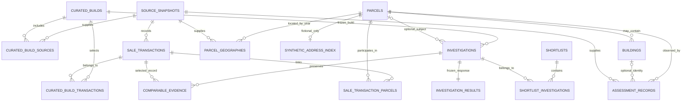

# P3 application contract and integration review

**Reviewed:** 22 November 2026; **CI evidence addendum:** 23 November 2026. **Status:** Synthetic-only application contract included in the authorised repository integration. Integration and passing tests do **not** constitute final P3 acceptance, external deployment, or connection to publisher records. **Prior verified baseline:** `main` at `cd98592f4b20bd02362ec0802db989ac7e94ee32`.

This is the **single current P3 application contract for the integrated candidate**. Earlier v0.1–v0.5 notes remain historical local review material and should not become competing current implementation instructions. The [engineering contract](ENGINEERING_CONTRACT.md) and [lean engineering directive](LEAN_ENGINEERING_DIRECTIVE.md) govern correctness and delivery.

## Buyer journey implemented with synthetic fixtures

1. The local page accepts a 14-digit invented parcel PIN, building area, optional user-reported asking price and label, and analysis date. Pilot township `17` and assessor class `203` are fixed for this demo. PIN is an internal lookup key, **not** approved consumer address search.
2. The local HTTP boundary validates the request and passes it to a SQLite fixture store. Only the server chooses the curated build, its source snapshots, location, assessments and recorded transactions.
3. The store resolves the subject using exactly one prior-tax-year assessment from the selected build; missing or ambiguous records abstain. Candidates are restricted to eligible transactions from the same build. Multi-parcel sales are excluded as individual-house comparables.
4. The unchanged Phase 2 matcher applies earlier-only sale dates, unique comparable PINs, class and township restrictions, floor-area tolerance, neighbourhood preference and bounded exploratory geographic fallback. Prices do not influence eligibility/ranking.
5. The store saves an investigation, selected evidence and a hash of the frozen response in one SQLite transaction. The result can be reopened by UUID; tampered or inconsistent saved evidence fails closed.
6. The page displays fabricated comparables, selection explanations, evidence status, provenance and warnings. No numerical valuation is returned. Saved records disappear when the local in-memory server stops.

**Run locally, with explicit fixture opt-in:**

```bash
python -m backend.run_synthetic_api --fixture-only --port 8765
```

The server listens only on `127.0.0.1`. It is not authorised for public deployment, importing real records, user accounts or client data. Python standard library and SQLite are sufficient for this isolated slice.

## HTTP and status contract

| Method and path | Meaning |
| --- | --- |
| `GET /` | HTML application |
| `GET /assets/styles.css`, `GET /assets/app.js` | Exact allowlisted browser assets |
| `GET /health` | `{ "status": "ok", "mode": "synthetic_fixture_only" }` |
| `POST /v1/investigations` | Validate, investigate, save and return an invented-fixture result; HTTP `201` plus `Location` |
| `GET /v1/investigations/{uuid}` | Reopen saved immutable result; HTTP `200`, or `404` when absent |

The `POST` request is JSON with allowed top-level fields `township_code`, `class_code`, `analysis_date` and `subject`. Allowed subject fields are `pin`, `building_area_sqft`, `asking_price_usd` and `label`. Caller-provided coordinates, neighbourhood codes, source metadata, candidate lists, synthetic flags and IDs are prohibited. An illustrative valid request:

```json
{
  "township_code": "17", "class_code": "203", "analysis_date": "2024-07-01",
  "subject": {
    "pin": "00000000000001", "building_area_sqft": 1600,
    "asking_price_usd": "500000.00", "label": "Synthetic buyer example"
  }
}
```

The service uses one of four **API-facing statuses**:

| Status | Meaning and pricing restriction |
| --- | --- |
| `supported_neighbourhood` | At least the policy minimum eligible sales in the same assessor neighbourhood; sale evidence is descriptive, not a validated valuation |
| `exploratory_spatial` | Bounded nearby sales only; carries the fallback accuracy warning, no valuation |
| `insufficient_data` | Missing PIN, absent/ambiguous assessment, weak sale coverage or missing trusted location; abstain |
| `out_of_coverage` | Unsupported market/class or resolved property outside scope; abstain |

The internal matcher retains `same_neighborhood` and `spatial_fallback` tier names; these are **not** the external status spellings. `valuation` is always `null`. The asking price is `user_reported`. A result records analysis date, immutable investigation ID, a curated `data_build` (build ID, UTC creation, source snapshot IDs, synthetic source type) and the provisional rule/contract version. Historical as-of availability and public source-display approval are both explicitly false in this candidate.

Validation errors use HTTP `422` with a field/code, malformed JSON uses `400`, missing/oversize bodies use `411`/`413`, invalid media type uses `415`, unavailable evidence uses `503` without raw SQL or source details, and unknown/mismatched routes use `404`/`405`. An unsupported-but-well-formed investigation is **a saved response**, not a validation exception. The local server rejects cross-origin/remote traffic and serves no general filesystem paths; these controls do **not** turn it into a production security boundary.

## SQL and source integrity

The 15-table proposed SQLite schema separates source snapshots, curated builds, parcels, buildings, sale transactions, transaction-parcel links, assessment-year records, geography, investigation responses/evidence and shortlists. It preserves: 14-digit PIN identity, one transaction across multiple parcels, unambiguous prior-year characteristics, correct snapshot roles, source-build membership, composite evidence foreign keys, transaction rollback, and saved evidence integrity checks. Shortlist tables exist in the proposed schema, **but shortlist creation and comparison are not implemented user features**.

The synthetic fixture store refuses non-synthetic builds. A string `synthetic-` marker is an extra safeguard against accidental dataset mixing, not cryptographic evidence that any arbitrary imported dataset is invented. There is no real-data ingestion, trusted public address resolver, authentication model, production migration strategy, independently validated price prediction, or permission to display property-level Cook County records.

## Current `development` experiment: fictional address selection (not final P3 approval)

**Added on 23 November 2026 to permanent `development` branch** at [`07f637b`](https://github.com/Sonkhe-Shongwe/house-price-intelligence/commit/07f637b1f0f9d04972911400381e38bda2687ba9). The stable `main` candidate described in the historical sections above remains a PIN-first contract until a reviewed integration. The P3 schema now includes a **16th synthetic-only index table on `development`**, not a production migration or sourced residential-address database.

| Development-only endpoint | Meaning |
| --- | --- |
| `POST /v1/addresses/search` | JSON `{"query":"Fictional Way"}`; matches zero or multiple invented address records, returning **candidate IDs and labels only**, with `source_kind=synthetic_fixture` and no automatic selection |
| `GET /v1/addresses/{address_id}` | Resolve an explicitly selected synthetic candidate ID to its stored parcel PIN; `identity_status=synthetic_mapping_only`; not a real building/address geocode |
| Existing `POST /v1/investigations` | Re-validate the user enquiry and independently resolve the chosen PIN against the trusted curated synthetic build; browser labels and client attributes are **never** trusted as publisher evidence |
| Existing `GET /v1/investigations/{uuid}` | Reopen frozen synthetic evidence with its saved price and source snapshot guards |

The search is a small bounded, parameterised SQLite lookup. It rejects unexpected fields and invalid query strings, returns no plausible address on zero matches, displays several choices without guessing and requires an explicit browser click. Existing origin/remote restrictions and fixture-only safeguards still apply. Four invented "Fictional Way" labels are used purely for integration testing; none represents a confirmed Evanston address or rights-approved consumer service. No real geocoder, external map service, published listing or valuation was added.

**Verification:** [development push CI 45193537292](https://github.com/Sonkhe-Shongwe/house-price-intelligence/actions/runs/45193537292) passed **132 Python tests, JavaScript syntax, docs checks and 5 actual Chromium -> HTTP -> SQLite scenarios** including supported search/select/reopen and no-match safety. It is integrated into the **development working branch only** and included in [draft PR #4](https://github.com/Sonkhe-Shongwe/house-price-intelligence/pull/4). P3 exit approval, exact-money API, real identity model and dataset display permissions remain unresolved.

## New `development` refinement: selected-address identity and exact-money v0.3 (provisional)

Added at [`79a7c4d`](https://github.com/Sonkhe-Shongwe/house-price-intelligence/commit/79a7c4dfcb0e1c2e1543b138539c28aa5a118eae) on `development`, verified by [CI 45196929621](https://github.com/Sonkhe-Shongwe/house-price-intelligence/actions/runs/45196929621) (**137 Python + 6 real Chromium tests**, JavaScript and docs checks). These are *draft synthetic-only* endpoint changes, not approved final P3 or production contracts.

**Selected property binding:** `POST /v1/investigations` may include `subject.address_id` with a lowercase, bounded ID. The request may omit `subject.pin` when that ID is provided. SQLite resolves the ID from the invented address index into the canonical synthetic PIN inside the same server-side investigation path. If both PIN and ID are supplied, disagreement returns `422` with `field=subject.address_id, code=identity_conflict`; an unknown ID returns `address_not_found`. Neither condition writes a saved investigation. On a valid selection the saved result includes `subject.address_id`, canonical `subject.pin` and `subject.identity_status=synthetic_mapping_only`. An unselected technical PIN remains allowed in this fixture-only internal demo. The browser discards address selection when the buyer manually edits the PIN or types a different search.

**Fixed-scale response money:** For **synthetic HTTP investigations only**, `contract_version` is `p3-draft-v0.3`. Every disclosed comparable has `sale_price_usd` as canonical two-decimal **text**, such as `"525000.01"`, sourced from exact `price_usd_cents` in SQLite, and no numeric `sale_price` member. The frontend uses text and integer grouping, not floating-point conversion. Saved-result validation binds this string to the same exact cents, transaction, snapshot, sale authorisation and stored response hash. `subject.asking_price_usd` remains buyer-entered decimal text and `valuation` remains `null`.

The **pure Phase 2 matcher** remains numerically unchanged for research. The direct `build_investigation` *research adapter* retains its dated v0.2 fixture and numeric `sale_price` for compatibility; the SQLite-backed HTTP envelope performs the v0.3 conversion. The API is a synthetic demonstration, not an approved general-currency/production money contract. Do not use any of these fictional records as real property evidence.

## Proposed domain ERD and controlled fixture migration

**Source:** `backend/schema_draft.sql` and `backend/schema_migrations.py`, added to permanent `development` at [8ed4269](https://github.com/Sonkhe-Shongwe/house-price-intelligence/commit/8ed4269af18e42add85726ae0fd45e406b8019c4). This is a *synthetic-only candidate*, not the approved production model. The baseline has 16 application/fixture tables, and the version runner adds an independent `schema_migrations` table.



| Entity/grain | What it means | What cannot be inferred |
| --- | --- | --- |
| Parcel PIN | 14-digit parcel identity, with leading zeroes | The parcel contains one building, or had one residential sale |
| Building | Optional physical building identity belonging to a parcel | A historical assessment card identifies a verified building |
| Assessment record | Snapshot, parcel, tax year, card combination | Publisher data were available on the sale date |
| Sale transaction and transaction-parcel link | One source sale with zero or more parcel links; a transaction can link multiple parcels | A multi-parcel transaction's full price belongs to each parcel |
| Curated evidence build | Explicit source snapshots and role membership | All sources were independently historically available |
| Investigation and selected evidence | Buyer enquiry, source-bound transaction and frozen response | An appraisal, live listing, or current valuation |
| Fictional address index | Deliberately invented one-to-one address-to-PIN browser fixture | Real address-to-building-to-parcel cardinality, coverage or usage rights |

**Provisional SQLite migration contract:** The existing `schema_draft.sql` becomes the immutable v1 fixture script. Numbered `migrations/0002_fixture_query_indexes.sql` adds three relational query indexes. The runner requires foreign keys, contiguous recorded history, valid script SHA-256 hashes and matching SQLite `PRAGMA user_version`. It applies DDL and history updates inside an explicit transaction, rejects unknown existing databases, refuses downgrades and rolls back a failed migration. Existing data and a saved synthetic investigation survive a tested v1-to-v2 upgrade.

[GitHub Actions PR run 45200054027](https://github.com/Sonkhe-Shongwe/house-price-intelligence/actions/runs/45200054027) passed **144 Python tests** and **6 real Chromium journeys**, including 7 new fixture migration checks. The corresponding [development push CI 45200038440](https://github.com/Sonkhe-Shongwe/house-price-intelligence/actions/runs/45200038440) also passed.

**P3 acceptance still open:** The team must review the true parcel/building/address relationship for a rights-approved first market, choose the production SQL/migration/backup policy, validate historical availability and provenance, approve the money and endpoint contracts, and review privacy/security. The fixture-only runner is **not** a production migration, backup solution, publicly served dataset or release authorisation.

## Verification and remaining acceptance

**Verified in the isolated integration workspace before publication:** 12 Phase 0 tests, 12 Phase 1 tests, 14 Phase 2 tests, 4 aggregate-export tests and 83 P3 application tests: **125 Python tests passing locally** on Python 3.13. JavaScript syntax and local HTTP GET/POST/persist/reopen paths passed. The local test report alone was not GitHub CI evidence. Independent inspection now confirms [run 45059455620](https://github.com/Sonkhe-Shongwe/house-price-intelligence/actions/runs/45059455620) passed 125 committed tests plus documentation checks on Python 3.12 at [`e8b8f70`](https://github.com/Sonkhe-Shongwe/house-price-intelligence/commit/e8b8f70de2bb10fd61b9cec9cc1d12aabdc6cfef). It does not include the separately prepared uncommitted reopen-guard patch. Chromium graphical browser execution was blocked by administrator policy and remains unverified.

**Later 23 November 2026 evidence:** The earlier browser-blocked statement is dated historical context. Owner-supplied Windows screenshots now confirm **127 Python tests, 15 Chromium DOM scenarios and full synthetic browser-to-Python-to-SQLite success/insufficient/reopen/error journey** in an **isolated patched checkout**. The original repo was preserved. The patch's extra two backend tests and browser checks are **not in GitHub main/CI**, which still represents 125 committed tests. See [current checkpoint](../CHECKPOINT.md) and [continuity audit](../reviews/CONTINUITY_AND_DIRECTIVE_AUDIT_2026-11-23.md).

**Next acceptance gates:** Owner review of the integrated PIN-first experience and external status contract; full verification of any later reopen-guard patch; actual visual browser acceptance in a permitted environment; then real source rights, as-of availability and release/security review before any publisher data or public service.

The weighted project baseline **22.8%** and P3 **10%** are unchanged pending formal acceptance. Avoid inferring completion from the number of tests or this document.
