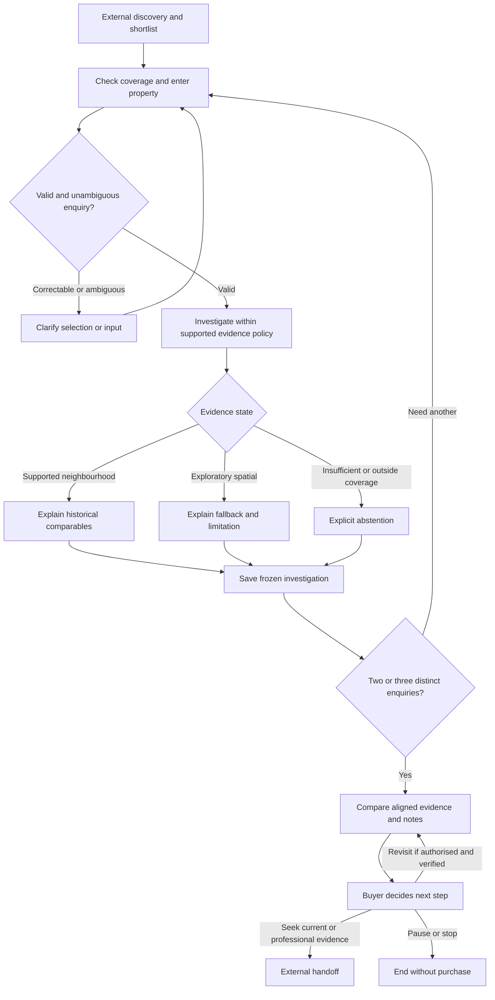

# P0-A.5 | Customer journey map

**Date:** 26 November 2026. **Status:** research-informed journey hypothesis, not observed customer behaviour, new implementation authority or real-data acceptance. **Authority:** [P0 directive](../engineering/P0_DISCOVERY_AND_FEASIBILITY_DIRECTIVE.md), original P0.1/P0.2/P0.6. Scope is an individual prospective owner-occupier considering two or three shortlisted homes. HPI-01 evidence-seeking buyer and HPI-02 unfamiliar-market variation share one workflow. See [personas](BUYER_PERSONAS_2026-11-26.md), [segmentation](CUSTOMER_SEGMENTATION_2026-11-26.md), [industry research](RESIDENTIAL_PROPERTY_INDUSTRY_RESEARCH_2026-11-26.md), [buyer problem research](HOMEBUYER_PROBLEM_RESEARCH_2026-11-26.md) and [product brief](PRODUCT_BRIEF.md). Prior evidence limitations retained. No new external research necessary for this synthesis.

## 1. Journey boundaries and evidence basis

Use evidence categories E = prior industry/population research, S = existing product scope or verified synthetic contract, H = hypothesised user behaviour/friction/outcome. S does not imply actual consumer success. A.1 establishes the industry process; A.2 establishes reported broad purchase difficulties, value of recent-sale information and high existing agent use/satisfaction; A.3/A.4 identify proposed customer and assumptions. No observed journey or emotion measurements; do not invent emotional curves, task times, conversion rates or loss estimates. Steps may overlap, repeat, be skipped or end without purchase. Current coverage is retrospective 2024-2025 sales / 2023-2024 prior-year assessment; not real-time or proven as-of. A current buyer might reasonably need newer evidence than HPI could provide.

## 2. End-to-end customer journey

| Stage | Buyer action, inputs and decision | Potential friction (H unless marked) | HPI touchpoint / boundary | Outcome or handoff |
| --- | --- | --- | --- | --- |
| J1 Preparation (external) | Clarify household needs, budget, affordability, financing and timing; decide readiness to search | Financing/supply hurdles observed broadly in A.2 (E); individual constraints unknown | None; HPI cannot approve financing or calculate affordability | Buyer, lender, housing adviser |
| J2 Discovery (external) | Search listings/agents, visit homes, record potential addresses and asking prices | Finding suitable property reported difficult in A.2 (E); listing details may vary | No live listing discovery, availability or image verification | Buyer identifies viable alternatives externally |
| J3 Shortlist / entry | Choose two or three candidate homes; enter location/identity, area and optional user-reported asking price | Unfamiliar identity/units, ambiguous address, missing attributes; adoption effort | Explain data class, geography and date boundaries; explicitly resolve parcel candidates where supported; validate inputs. Existing scope, not new real lookup approval (S) | Clear accepted enquiry, correctable error, or unsupported state |
| J4 Investigate | Examine recorded sale prices/dates, matched attributes, selection rationale and differences; decide if evidence is relevant | Confusing asking and completed prices, old sales, incomparable homes, unclear geography | Traceable earlier screened comparable evidence; distinguish neighbourhood, exploratory spatial and insufficient states; no valuation (S) | Understand evidence or abstention; identify missing information |
| J5 Compare | Save investigations for two or three distinct parcels; compare aligned evidence/attributes and caveats | Uneven evidence across homes, mental comparison burden, uncertain material differences | Existing frozen shortlist, notes and side-by-side comparison; include unsupported well-formed enquiries; no forced winner or imputed missing data (S) | Understand trade-offs and remaining questions |
| J6 Decision preparation / return | Record own notes, reopen evidence, revisit after agent discussions or changed preferences | Losing context, stale evidence, confusing reopened snapshot with new analysis | Preserve original frozen result subject to verification and permitted lifetime; label dates; maintain decision autonomy (S) | Proceed with questions, investigate another home, seek more evidence, pause or abandon |
| J7 Offer / due diligence (external) | Decide whether to make an offer, negotiate, commission condition/valuation checks, confirm financing/title | Time pressure and uncertainty (E broad, individual H) | Evidence review may complement professional discussion; no offer price prescription, legal advice, condition guarantee or appraisal | Buyer, agent, inspector, appraiser, lender, attorney/settlement providers |
| J8 Closing / purchase (external) | Complete contractual purchase or withdraw | Settlement and recording issues outside scope | None; no transaction execution or automatic tracking | Closing/recording may later create historical evidence, with publication lag |

Primary intervention J3-J6 = Investigate / Compare / Decide. HPI entry occurs after discovery. Decision means preparing a buyer's own next action, not purchase recommendation. No obligation to buy; a correct abstention is a useful outcome.

## 3. Conceptual product flow and alternative paths

This represents intended decision logic, not new UI design, production API or actual observed path. J3 entry guard distinguishes malformed/conflicting identity (reject, no investigation) from a well-formed unknown or unsupported enquiry (may be saved with explicit abstention under existing synthetic contract). A no-match address is not silently turned into a guessed parcel, and a failed lookup cannot reuse a previous selection. Exact real address eligibility remains open. J4-J6 data handling is conditional on authorised snapshot/access and verified storage; any expired or corrupted evidence must not be disclosed.

## 4. Critical journey states and recovery

| State / risk | Expected behaviour grounded in existing scope | Evidence boundary |
| --- | --- | --- |
| Invalid price/area or conflicting identity | Explain correctable input, no false success or investigation from invalid request | P3 fixture contract; final real entry validation pending |
| Ambiguous or no-match address | Require explicit supported selection; no automatic guess; no claim of physical-building verification | P3 fictional address -> parcel only; real cohort P0.4 open |
| Valid outside-coverage / insufficient evidence | Show truthful status, preserve well-formed entry, no fabricated comps or valuation; may compare alongside supported home | P3/P6 synthetic and existing brief |
| Exploratory spatial fallback | Label weaker geographic evidence; no numerical fair-price or market-wide claim | P3 and prior corrected holdout; fallback error limits retained |
| History outdated for present buyer decision | Explain source window and retrospective limitations; seek current data externally when needed | A.1 and A.2; P0-C must decide actual viable temporal scope |
| Comparison with uneven support | Align attributes/status/dates and expose uncertainty, no forced ranking; note own questions | P6 fictional contract, no measured consumer preference |
| Duplicate property / fourth entry | Explain two-to-three distinct-property scope; correct membership within permitted contract | P6 fixture rules; do not promise unqualified private edit behaviour |
| Unsaved note or unavailable service | Preserve draft/recover only as existing qualified mode permits; distinguish no saved records from failure | Workspace fixture contract, actual combined private lifecycle acceptance still open |
| Reopen after restart / tamper / expired retention | Reopen same verified frozen evidence only if authorised, not silently rematch; fail closed on integrity/access/expiry | P6 fixture and private invented proof; actual private combined restart/notes and retention inventory outstanding |
| User wants professional advice or current price | Explain boundary; seek current sources, agent, appraiser, lender or inspector as appropriate | Existing product exclusions, no professional replacement |

## 5. Touchpoints and existing implementation mapping

| Touchpoint | Existing canonical evidence | Distinction |
| --- | --- | --- |
| Investigate / entry and evidence dossier | [P3 contract](../engineering/P3_APPLICATION_CONTRACT.md) | Fictional search and parcel-only identity, validated request, four evidence statuses, frozen response, no valuation |
| Workspace / history and reopen | [Buyer Workspace UX](../engineering/BUYER_WORKSPACE_UX_V1.md) | Bounded history, navigation, saved investigation verification and draft protection in synthetic mode |
| Compare / notes | [P6 shortlist](../engineering/P6_SYNTHETIC_SHORTLIST_CONTRACT.md) | Fictional 0-3 members; aligned display at 2-3, notes, duplicate and tamper checks; fixture persistence opt-in |
| Controlled real-data path | [Private beta](../engineering/PRIVATE_REAL_DATA_BETA_V1.md) | Narrow redacted projection; actual invented provider integration partly accepted, no live real route or permitted collection/display. Raw comparable PINs/doc IDs, addresses, geometry and arbitrary source fields not approved for browser disclosure. Do not treat broad synthetic display or edit capability as a real-data entitlement. |

Reuse one workspace; both personas share all stages. HPI-02 may need additional explanation of geographic relevance and fallback but does not require a separate interface, map provider or live data. No new implementation, map refresh, storage policy or data rights proposed. For actual implementation status consult [checkpoint](../CHECKPOINT.md), not historical percentages in dated engineering documents.

## 6. Decision outcomes and hypotheses to validate

Success candidate: buyer correctly explains the difference between asking and recorded sale price, understands why evidence is eligible or insufficient, compares at least two distinct enquiries with caveats intact and articulates a next action or question without treating HPI as a valuation. This is a proposed task outcome, not measured behaviour or final threshold. Both a useful comparison and a correctly understood abstention can succeed; a forced purchase, longer session or higher engagement is not itself success.

Disconfirming cases: buyer already has adequate current agent/portal evidence; data too stale or narrow to inform current decisions; effort to enter/save exceeds incremental benefit; buyer interprets comp evidence as a recommended offer despite warnings. These must remain visible in later A.6/A.7/A.9 and P0-B/C. No interviews or tests executed in A.5; later task research needs approval where real participants/data are involved. No fake emotion scores or quotes.

## 7. Stopping criterion and handoff

A.5 requires steps, decisions, inputs, friction, handoffs and HPI value without substituting for professional advice. End-to-end and alternative paths, existing contract traceability, entry/coverage and recovery limitations, boundary and validation hypotheses are documented. Bounded synthesis stopping criterion met; not proof of observed journey or product usefulness. P0-A.1-A.5 verified research/synthesis; original P0.1/P0.2/P0.6 and P0-A remain open. Next P0-A.6 Jobs to Be Done: identify and prioritise functional/decision jobs and alternatives from existing research, not a new user journey or implementation. No phase credit, new property data, accounts, contact, spending, release, source rights or code changes.
