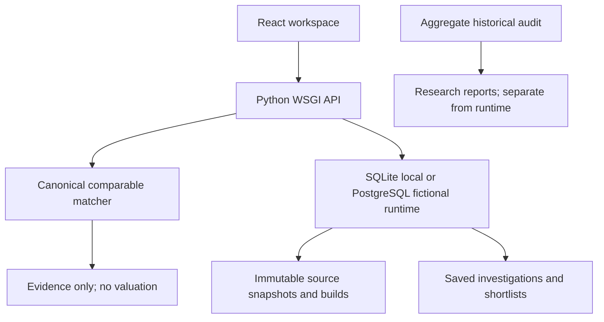

# Recruiter walkthrough: House Price Intelligence

**Working local fictional demo, not a live property valuation service.** Original real-data MVP remains in scope; no public release authorised.

## Run the actual application
Use Python 3.12 and Node 22 from the repository root. Build with `npm ci --prefix frontend/react` and `npm run build --prefix frontend/react`. Start `python -m backend.run_synthetic_api --fixture-only --frontend react --synthetic-map --port 8765`. Visit http://127.0.0.1:8765. Optional reviewed private SQLite file via `--fixture-db`; never use personal records. PostgreSQL acceptance is verified through hosted ephemeral CI, not a public demo URL.

## Five-minute walkthrough
| Time | What to show | Technical point |
| --- | --- | --- |
| 0:00–0:45 | Workspace, search 105 Fictional Court, select explicit parcel | Entity identity, ambiguity, no guessed building |
| 0:45–1:45 | Investigate PIN 00000000000001, default area/date, choose a sale, enable fictional map | Server-owned prior-year SQL join, deterministic eligibility and exact cents |
| 1:45–2:45 | Save to shortlist, add a different PIN, compare aligned evidence | Frozen build and source snapshots; notes mutable separately |
| 2:45–3:30 | Unknown PIN 99999999999999 | Abstention, no fabricated estimate |
| 3:30–4:30 | Explain PostgreSQL source activation, rollback, two fictional identities and pooled transactions | RLS, least privilege, concurrency and immutable evidence |
| 4:30–5:00 | Show CI and aggregate research limitations | Reproducible verification, chronological evaluation, source rights |

## Architecture

## SQL explanation
Prior-tax-year assessment membership uses a build-bound join on snapshot, parcel PIN and tax year; accept exactly one assessment row. Sale transactions and parcel links are separate: exclude multi-parcel transactions as one-home priced comparables. The frozen result links transaction ID, source snapshot, exact cents and match policy. See [runtime](../engineering/PRODUCTION_RUNTIME_V1.md) and [consolidation](../engineering/PRODUCTION_CONSOLIDATION_V1.md). No inference of historical publisher availability from tax year.

## Honest limitations
No validated valuations, real field publication rights, real building identity, real map locations or deployed login provider. Offline OIDC tests do not prove a live identity integration. No production deployment or final owner UX acceptance. Show only actual fictional CI screenshots and aggregate research. Do not claim real user counts, production SLA or employer endorsement.
